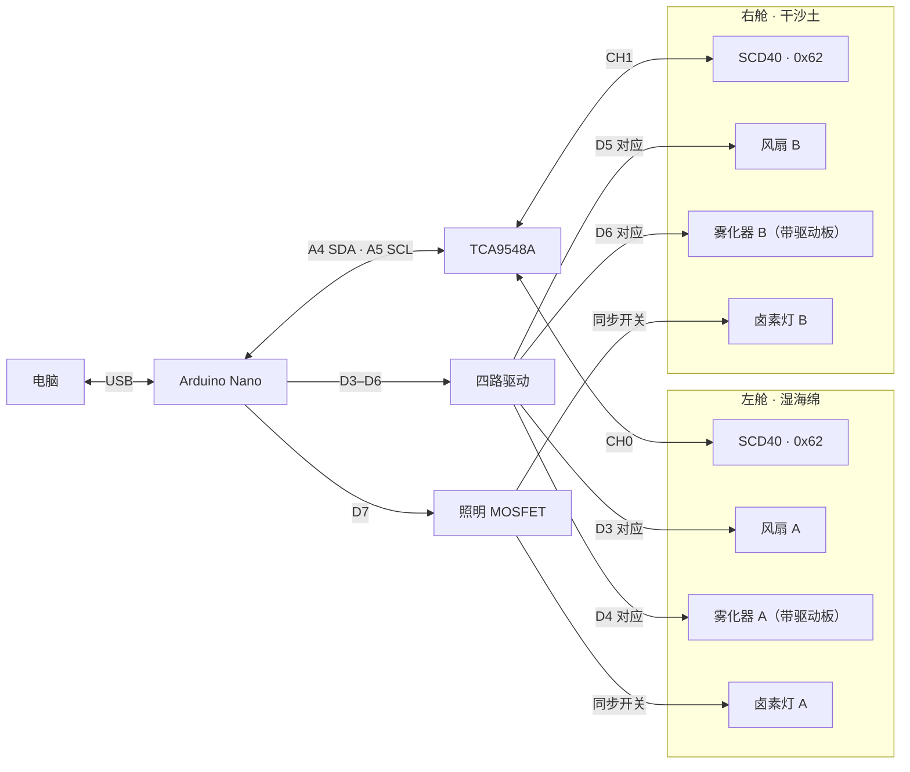
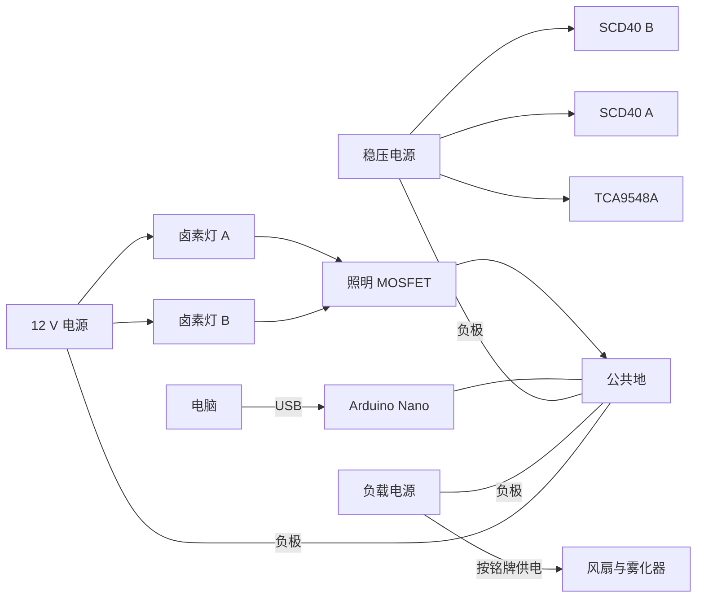

# 双舱温室电路设计 v1

左舱放湿海绵，右舱放干沙土。两舱各配置一颗 SCD40、一台风扇、一套水雾化器和一盏卤素灯。两舱共用一块经典 Arduino Nano v3.0，电脑通过 USB 显示和记录。箱外另放一个独立温湿度计，记录环境基线。

项目课件第 4–5 页要求实时显示舱内温度、相对湿度和 CO₂，并支持到达阈值时自动启停设备。第 16 页列出 Nano、SCD40、六针 OLED、继电器和超声雾化组件。第 27 页要求测试某个变量对舱温的影响，自变量至少改变五次，并用表格和图展示结果。

## 系统框图

## 供电图

## 接线表

| Nano 引脚 | 连接 | 说明 |
|---|---|---|
| A4、A5 | TCA9548A 上游 SDA、SCL | 地址脚 A0/A1/A2 接地，地址 0x70。每次只启用一路，同地址的两颗 SCD40 分别接 SD0/SC0、SD1/SC1。 |
| D3、D5 | 左、右风扇驱动输入 | 初版做开关控制，按两线直流风扇设计。 |
| D4、D6 | 左、右雾化器驱动输入 | 接整套雾化驱动模块的 EN 或经驱动开关控制其供电。先验证断电重启是否自动喷雾。 |
| D7 | 照明 MOSFET 控制输入 | 两盏 12 V 卤素灯并联，由同一路开关同步控制。 |
| USB | 电脑 | 供 Nano 电源、上传程序和记录串口数据。 |
| GND | 电源负极、驱动和各模块 GND | 执行器大电流回路直接回电源负极，逻辑地单独汇接到同一公共地。 |

**传感器支路。** 按手上模块的 VCC 和信号电平规格接线，尤其要检查模块自带的 SDA/SCL 上拉接到哪一路电源。如果两颗模块的供电和总线都明确支持 5 V，可统一使用 5 V 逻辑。若模块为 3.3 V 总线，按 TI 的电平转换接法给 TCA9548A 供电并配置各段上拉。两颗 SCD40 的瞬时供电预算合计按约 410 mA 计，另外加上其余逻辑模块电流。

**负载支路。** 两线风扇用 5 V 栅压下有明确导通规格的逻辑级 N-MOSFET 做低边开关。负载正极接额定电源，负极接漏极，源极接 GND。Nano 经约 100 Ω 接栅极，栅极用 10 kΩ 下拉到 GND。普通有刷电机加续流二极管，阴极接负载正极，阳极接漏极。雾化片连接原配驱动板，优先用驱动板的 EN。没有 EN 时，若模块上电即启动，可用学校的继电器模块切断该模块的正极供电，使用 COM 与 NO，并确认控制端默认关闭。若需要按键启动，先确认按键电路和控制方式再定接法。

**照明支路。** 每舱上方一盏同型号 12 V 卤素灯，20 W 为试装规格。两盏灯并联，正极接 12 V，共用一个低边 MOSFET，源极接 12 V 负极，控制端下拉使其上电默认关闭。合计稳态电流约 3.3 A，电源、开关和走线按冷灯丝启动电流选型。灯装在箱外，用耐热灯座固定并与箱体留出距离。

**电源容量。** Nano 的单个 I/O 最大 20 mA，只发送控制信号。风扇和雾化器由外部低压直流电源供电，电压按铭牌选。负载走线直接从电源端子分配。传感器稳压支路可在核对电压、电流和压降后选用学校的 MB-102。外部稳压电源与 USB 供电的 Nano 共地，两路 5 V 保持独立。

## 布局和实验模式

- 在左右舱背板各开独立穿线孔并封缝。隔板顶到底封严，优先使用泡沫板。Nano、驱动板和电源装在箱外。两颗传感器在舱内同一高度、同一相对位置，避开喷雾直冲和灯的直接辐射。风扇按舱内循环设计。
- 两颗 SCD40 分别启动周期测量，程序每约 5 秒逐舱读取就绪数据，经 USB 串口发送，电脑显示并记录带时间戳和舱标记的读数。
- 两盏灯同步开启并保持固定功率。需要喷水雾时，同一指令同时启停两台雾化器，并记录时刻。风扇运行策略和 CO₂ 投放流程留待实验方案确定。

## 上电验收

先检查左右通道能否分别读出 0x62，再验证电脑端串口标签。逐路试开风扇和雾化器，核对左右对应关系、复位默认关闭行为，以及雾化器的重新启动方式。验证两盏灯和两台雾化器能分别同步启停。最后测试多路同时运行时的电源压降、Nano 复位与传感器读数，并检查穿线孔和隔板封缝。

本版采用经典 5 V Nano、有线采集、两线直流风扇和带驱动的雾化器。引脚资源足够。装配前需核对负载的铭牌电压与启动电流、雾化器的控制方式和 SCD40 模块允许的电平。方案尚未经过实物通电验证。

参考资料 [Arduino Nano 引脚图](https://docs.arduino.cc/resources/pinouts/A000005-full-pinout.pdf) · [Sensirion SCD40](https://sensirion.com/products/catalog/SCD40) · [TI TCA9548A 数据手册](https://www.ti.com/lit/ds/symlink/tca9548a.pdf)
